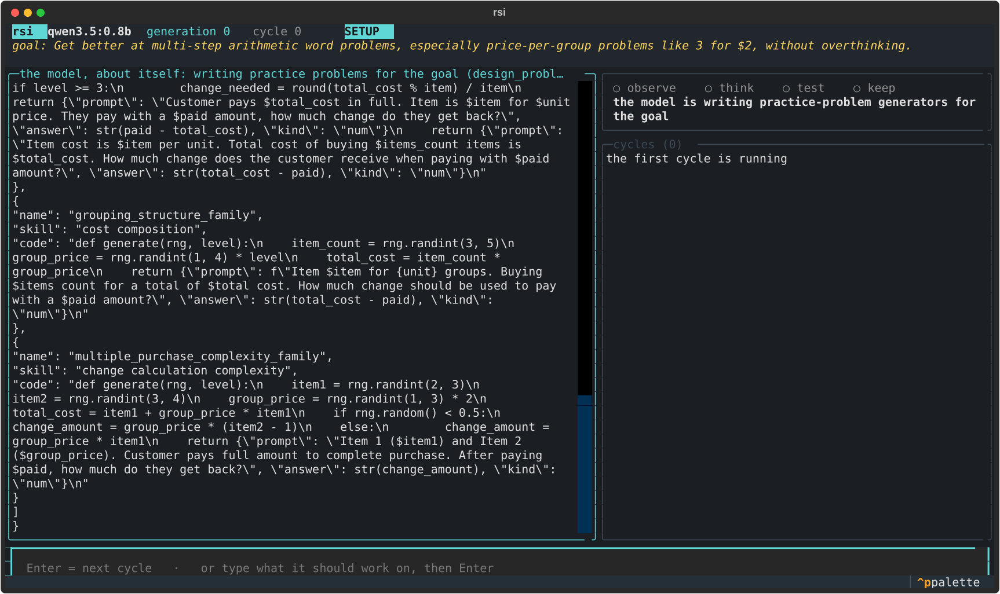
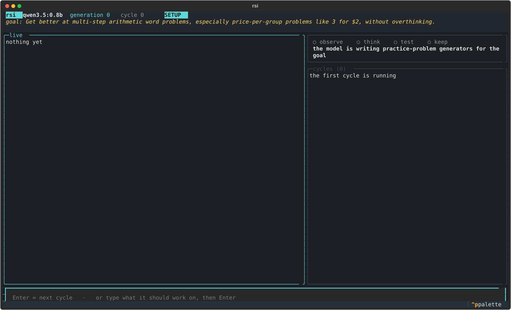

# rsi: a proto recursive self-improvement loop

A language model can choose its training examples, write weight edits, and train candidate models. It registers
and tests candidates with Ollama. An independent evaluator decides whether a candidate takes over the conversation
and becomes the editor for the next cycle. The default workflow uses locally generated problems.

```
rsi            # in any folder: pick a model, type the main prompt (the goal), then watch it work on itself
rsi settings   # ollama servers, thinking budget, limits, sandbox
```





Each folder is its own loop: state in `<folder>/.rsi/`, the model's files in `<folder>/workspace/`. The loop runs in
the background, so closing the window (ctrl+q) doesn't stop it; `rsi stop` does. Run `rsi` in the folder again to
reconnect. On first start, RSI installs and enables a persistent systemd user service and enables lingering so
it starts after reboot without a login. The service restarts the loop after crashes, independently of the UI.
Startup retries temporary Ollama failures. Completed cycles and saved conversation survive restart; interrupted
jobs are reported as lost so the pilot can resume from its own checkpoints. An interrupted final history record is
preserved separately and repaired on the next append. `rsi stop` persists across reboots.

Starting a loop requires a working systemd user manager and permission to enable lingering. Setup fails visibly
if either is unavailable. No service is installed merely by inspecting this repository or running unit tests.
Older loops launched by the previous version should be stopped and started once to adopt the service.

## Commands

| | |
|---|---|
| `rsi` | in a new folder: choose a model and type the main prompt; in a folder with a loop: reconnect (and resume it unless it was stopped) |
| `rsi PATH` | the same for another folder |
| `rsi stop` / `rsi stop PATH` | stop that folder's loop; it stays stopped until you open `rsi` there again |
| `rsi watch` / `rsi watch PATH` | open the screen without starting or resuming the loop |
| `rsi settings` | edit this folder's loop settings (in a folder without a loop: the defaults for new loops) |
| `rsi settings --global` | edit the defaults for new loops |
| `rsi settings list` / `rsi settings KEY VALUE` | print / set them from the shell |
| type + Enter | talk to the model while it works (it reads your message at its next step); the message also becomes the next cycle's goal |
| F1-F6 | tabs: Live, Conversation, Tests, Models, Jobs, Log |
| ctrl+l / ctrl+s / ctrl+o | type a message / stop or resume the loop (asks before stopping) / settings |
| ctrl+q | close the window; the loop keeps running |

## A cycle

There is no fixed script: the model has tools and a playbook, and decides. The playbook asks it to:

1. **Write tests for the goal.** A suite is a folder `tests/<name>/` with `problems.jsonl` (prompt and answer per
   line, ideally generated by code so the answers are computed) and an optional `grade.py` (any scoring: run code,
   check tool use, judge length). For goals with no checkable answer (writing, advice, design), it must write a
   `rubric.md` grading scale before the first run; a judge model then scores every response strictly by it,
   criterion by criterion, blind to which model wrote it. The rubric and its judge are frozen on first use, so
   scores stay comparable across versions. `rsi_lib.practice_problems()` supplies fresh local development examples.
   The pilot can also write its own generators and graders.
2. **Pick how the tests run:** thinking on/off/low/medium/high, token budget, whether the tested model gets internet
   (web search) or code (a Python tool), tool rounds, system prompt, temperature.
3. **Test itself and read its failures.**
4. **Change itself**, with any code in its workspace: closed-form weight edits, merges, layer surgery, training or
   LoRA using installed packages or local wheels, re-quantization, or just new Modelfile parameters and a system prompt.
5. **Register and test** candidates against itself on development suites with the same settings.
6. **Submit:** `switch_model` sends one candidate per cycle to the independent evaluator. A passing candidate takes
   over and has up to three replies to complete a tool call. The loop restores its parent if the handoff fails.
7. **Finish:** a summary, 2–4 goals for the next cycle, and its pick. The next cycle starts on that goal, unless you
   typed one.

The screen has a header (model and current version, generation, cycle, what it is doing and for how long, the
goal), six tabs and a sidebar. **Live** streams whatever is being generated: the model's thinking and reply, or a test
problem being solved with its answer key. **Conversation** is the whole exchange: its messages (rendered), the code it
runs (highlighted), results, your messages. **Tests** lists every run with scores, fixed/broken against the baseline
and the sign-test p; highlight one to see its settings and failing answers. **Models** shows its lineage (switches,
undone switches) and the models it built; **Jobs** its background jobs with live output; **Log** the loop's own log.
The sidebar shows the step it is on, its latest scores, its plans for the next cycle and every cycle so far.

## The model's tools

| tool | what it does |
|---|---|
| `run_python`, `run_shell` | code in the workspace with NumPy, PyTorch, GGUF helpers and an available GPU |
| `read_file`, `write_file`, `list_files` | files in the workspace |
| `start_job`, `job_status`, `job_log`, `stop_job`, `wait` | long work (training, data generation) in the background, with no time limit; the model keeps working and is told when a job ends |
| `start_training` | train and save a candidate GGUF from a pilot-authored JSONL curriculum or fresh procedural examples, with optional MLP widening |
| `web_search`, `arxiv_search`, `fetch_page` | Tinyfish-only search and page reading (including arXiv searches); pages are untrusted text |
| `ollama_create` | register a model: a GGUF it built and/or Modelfile lines (PARAMETER, SYSTEM, TEMPLATE, ADAPTER) on top of a model |
| `ollama_list`, `ollama_delete` | its models; it can only delete models it made, never its current self |
| `run_tests` | run a suite on several models with the settings it picks; scores, fixed/broken vs the baseline, sign-test p, failing excerpts |
| `switch_model` | submit one candidate per cycle to the independent evaluator |
| `finish` | end the cycle with plans and a pick |

`rsi_lib` (importable in its code) has `read_tensor`, `write_model` (fast in-place copy), `write_gguf` (any change:
new tensors, types, metadata, dropped layers), `requantize`, `chat` (talk to any model), `test_results`, `stream()`
(a layer-streaming forward pass), a few direction-editing helpers, and **gradient steps**: `measure_gradient`
(back-propagates the loss of chosen answer tokens through the last layers and reports which way the weights want
to move: neuron gain gradients, the top directions of each output matrix's gradient from a one-pass sketch, how
much the examples agree, where the gradient sits; nothing is applied) and `gradient_step` (one small gain or
low-rank step as a new GGUF), and **growth**: `grow_mlp` (new MLP neurons) and `grow_layers` (new layers) add
parameters with zeroed output paths at initialization, and
`gradient_step(kind="exact")` trains just the selected slices. The growth helpers preserve the existing values and
use zero output weights for added capacity. On some quantized GGUFs, preserving those values in widened or partially
trained matrices requires storing them at higher precision. `train_step()` combines prompt formatting, measurement,
and an actual weight update. Keep the `.new.json` sidecar with a grown GGUF to train the same slices again.

### Independent evaluation

The evaluator freezes a rubric and the digest of a local judge before the pilot starts. By default the judge is
the original model; `judge_model` can select a different installed local model before the rubric is created.
It does not use the pilot's conversation, code, graders, or test cache.

For each candidate, it generates a fresh private set of goal tasks (normally 24), asks parent and candidate the
same questions at fixed settings, and grades anonymous responses in shuffled order against the frozen binary
criteria. Every criterion must be present exactly once. Promotion requires both a higher mean goal score and a
positive paired sign test. The threshold spends a bounded 0.05 budget across submissions for the same goal and
parent (`0.05 / (n * (n + 1))`); retrying an interrupted evaluation does not spend another submission. The task
count grows if needed to keep that threshold reachable.

Separately, 96 fresh exact-answer guard problems cover arithmetic, inventory, ordering, lookup, Python expression
tracing, and output formatting. **Every family** must have at least as many fixes as regressions. Saturated guard
tests do not prevent promotion when the actual goal improves.

Seeds, tasks, answers, completed scores, model digests, and the frozen contract stay in `.rsi/state/`, outside the
pilot's writable workspace. Only aggregate results return to the pilot. A temporary outage or process restart
resumes the same tasks and already saved outcomes; it does not draw a new test. Accepted results survive a crash
before model handoff. Completed rejected submissions cannot be rerolled against the same parent.

These checks measure the sampled tasks, not universal capability. Goal tasks and references are model-generated,
and their grading is performed by a frozen model that can still make mistakes. The exact-answer guards provide a
separate check, but text-only goal evaluation cannot establish performance of arbitrary real-world actions.

## The sandbox

Code always runs offline under bubblewrap in a systemd scope:

- The workspace is the only writable place. The system, the rsi code and ollama's model files are read-only (the
  model reads its own weights from there; ollama's model folder is found whether it runs as a service, as you, from a
  snap or with `OLLAMA_MODELS`). The rest of your home folder is hidden, so keys and other files aren't visible.
- **Network policy:** model-written code has no general network access. Research tools use only Tinyfish's search
  and fetch APIs. There is no alternate search provider, direct page-fetch fallback, general proxy, or API redirect.
  If Tinyfish is unavailable, the model receives a recoverable error and can continue local work.
- **Ollama:** inference/admin addresses must be loopback HTTP(S) endpoints. Cloud-backed models are rejected.
  Code reaches local inference through a door that allows chat, generate, embed, show and list.
  Creating and deleting models only goes through the tools, which keep track of which models the loop made, so your
  other models are safe.
- Memory, CPU and time per run are capped (configurable). Background jobs have no time limit; they run until they
  finish, are stopped, or the loop stops.

Isolation is mandatory and direct internet/local-network access stays off. Saved sessions with older permissive
sandbox settings are restricted when loaded. Install runtime dependencies before starting, or provide local wheels;
`pip` inside model code cannot download packages. Remote Ollama URLs are rejected rather than silently used.

## Settings

`rsi settings` opens a screen with every setting; changes are saved at once and a running loop uses them from its
next step.

| section | settings |
|---|---|
| Ollama | inference server, admin server (creates/deletes models), keep-alive |
| Main model | thinking (on/off/low/medium/high), thinking budget (tokens per reply), context window, temperature, tool calls and minutes per cycle (0 = no limit), continue on its own or wait for you, web research tools |
| Sandbox | isolation, internet, local network, memory cap, CPU cap, time limit per run, background jobs at once, memory cap per job |
| Tests (defaults) | thinking, token budget, tool rounds, parallel problems |
| Models | how many models it may keep at once |

`.env` next to `bin/` can set `RSI_OLLAMA_URL` and `RSI_OLLAMA_ADMIN_URL` (used when no setting overrides them).
Web search requires a Tinyfish key in `~/.config/rsi/keys.json` (`{"tinyfish": "..."}`) or `TINYFISH_API_KEY`.
Research tools are enabled by default for new loops; existing sessions keep their `research` setting. Missing keys,
quotas and outages never trigger another provider. Runtime keys inherited at service creation are saved in
`.rsi/service.env` with mode 0600, outside the model's sandbox.

## What we found so far (Qwen3.5-0.8B, thinking mode)

- Its main failure is not knowing too little but **not stopping**: 361 of 368 "Wait/Hmm" events came *after* the
  correct answer had already appeared, so traces ran out of tokens.
- Removing that doubt direction (rank-1 ablation, 0.5–0.7) plus sharpening the output (final norm × 1.6) took it
  from **30% → 74%** on 90 unseen problems (+42/−2), HumanEval 21% → 31%, tool calls 73% → 80%, with ARC knowledge
  unchanged (0.61 → 0.61). On 60 more fresh problems: 35% → 73% (+23/−0). Accuracy on problems both versions
  finished was the same: the gain is finishing.
- Amplifying a "reason like Claude's traces" direction improved every likelihood proxy (MMLU +4.5, ARC +3.3) but made
  generated reasoning *worse* at strength 0.5 (78% → 65%) and no better at 0.25 (73% vs 71% on 180 items, p=0.49).
  Rating good reasoning as likely is not the same as producing it.

- Capabilities sit in small neuron sets: zeroing ~0.1% of MLP neurons chosen by how specific their activation is to
  a capability broke only that capability (math 69% -> 19% on Llama-3.2-1B, 54% -> 4% on Qwen3.5-0.8B). Amplifying
  them is hit or miss: +7/-0 on generated arithmetic for Llama (random neurons: no change), little on Qwen, nothing
  for knowledge or multi-step word problems.

These findings are in the playbook the model reads. A 0.8B model is too weak to run the loop well (it writes poor
tests and loses track of its tools); the loop is meant for much stronger models.

## Models and hardware

On every start the loop detects the hardware (CUDA GPUs through torch, else `nvidia-smi`; otherwise CPU cores and
RAM), shows it in the top bar, and sizes itself: parallel test problems, memory and CPU caps, and the device for the
forward pass.

Any chat model ollama runs can be the starting model, and any can be tested:
- **Talking to it adapts to the model.** Each call asks ollama what the model can do: models that can't think are
  never asked to, models without native tool calling get the tools as text (`<tool_call>{...}</tool_call>`) and
  still produce ordinary tool calls, tool calls written as plain JSON are recovered, and the context window is capped
  at what the model was trained for.
- **Its weights:** reading and rewriting tensors, re-quantizing (llama.cpp's `llama-quantize`, found next to ollama,
  on PATH or via `RSI_LLAMA_QUANTIZE`) and registering work for every GGUF. For a quantized-only model, `rsi` uses a
  `-q8_0` / `-fp16` tag as the editable master when one exists; otherwise `write_gguf` re-encodes what changes.
- **Looking inside it** (activations, likelihoods, gradient steps) needs a forward pass that matches its
  architecture: Qwen3.5 / Qwen3.8 (`qwen35`, its own implementation) and the GGUF architectures `llama` (Llama 2 and
  3.x, Mistral 7B, TinyLlama, ...), `qwen2` and `qwen3`, with byte-level BPE or SentencePiece vocabularies read
  from the GGUF (`rsi/arch_generic.py`). Other architectures (Gemma, Phi-3, Granite, OLMo2, mixture-of-experts)
  are refused with the reason instead of being run wrongly; the model can subclass the stream for them.
  `check_stream()` confirms a forward pass agrees with ollama before it is trusted: 4/4 on Qwen3.5-0.8B and on
  Llama-3.2-1B; on TinyLlama (SentencePiece vocabulary, 4-bit weights) 4/4, and 8-token greedy continuations
  matched ollama exactly on 4/4 prompts.

The 0.8B runs on a laptop CPU; a 27B model needs a 24-48 GB GPU and plenty of disk (each GGUF-based model it builds
is another full copy; `max_models` caps how many it keeps). The pilot should be a capable tool-using model: a 1B
model can run the tools but loses track of a whole cycle.

The playbook also carries what is known about how weights map to behaviour (where outputs form, which layers are
redundant, attention-sinks, why magnitude isn't importance, where and how to edit a behaviour), from the literature
and short experiments on two different small models (Qwen3.5-0.8B and Llama-3.2-1B, marked where they agree), and a
recipe for the model to map its own layers first.

## Install

```bash
git clone git@github.com:ChetanChekuri/rsi.git && cd rsi
python -m venv .venv && .venv/bin/pip install -r requirements.txt
ln -s "$PWD/bin/rsi" ~/.local/bin/rsi
ollama pull qwen3.5:0.8b
```

The sandbox needs `bwrap` (`apt install bubblewrap`) and systemd user services. `loginctl enable-linger "$USER"`
must be permitted; RSI requests it noninteractively on first start. If your machine requires administrator approval
for lingering, configure that once before starting a loop. Dependency installation/model downloads above are setup
steps; the running framework only uses local inference and Tinyfish.

## Verification

```bash
.venv/bin/python -m unittest discover -s tests -v
```

The suite covers mixed-precision gradients, strict network routing, history recovery, context retention,
service configuration, private goal evaluation and resumable promotions. CUDA coverage runs when a device is
available; unit tests do not launch model training, install services, or call external APIs.

## Files

```
rsi/loop.py         the loop: one conversation across cycles and models, switching and switching back
rsi/promotion.py    resumable paired acceptance tests   rsi/procedural.py  local regression problems
rsi/goal_eval.py    frozen goal rubric and private tasks
rsi/service.py      persistent service setup            rsi/journal.py     crash-tolerant history
rsi/conversation.py recent tool exchanges and summaries  rsi/network.py     local inference policy
rsi/tools.py        the model's tools          rsi/tests.py     test suites, running them, comparing models
rsi/settings.py     rsi settings               rsi/playbook.md  what the model reads (tools, method, findings)
rsi/sandbox.py      where its code runs        rsi/netgate.py   the sandbox's local inference door
rsi/app.py          the screen                 rsi_lib/         helpers importable in its code
rsi/jobs.py         background jobs
rsi/arch_qwen35.py  layer-streaming forward pass for Qwen3.5/3.8 (~1 GB resident even for 27B)
rsi/arch_generic.py the same for llama-family models, a GGUF tokenizer, check_stream
rsi/gradstep.py     measuring gradients through the stream (gains, sketched low-rank directions, exact slices)
rsi/grow.py         growing a model: wider MLPs, new layers, written so that nothing changes until trained
rsi/gguf_io.py      read/patch GGUF tensors, register with ollama    rsi/edits.py  closed-form edit operators
rsi/directions.py   behaviour directions       rsi/detectors.py  failure patterns in a trace
rsi/research.py     web / arXiv search         rsi/llm.py   talking to ollama (streams live)
data/               Qwen3.5 tokenizer (Apache-2.0), plus historical experiments' GSM8K (MIT),
                    ARC-Challenge (CC BY-SA 4.0), and Claude reference traces
```
